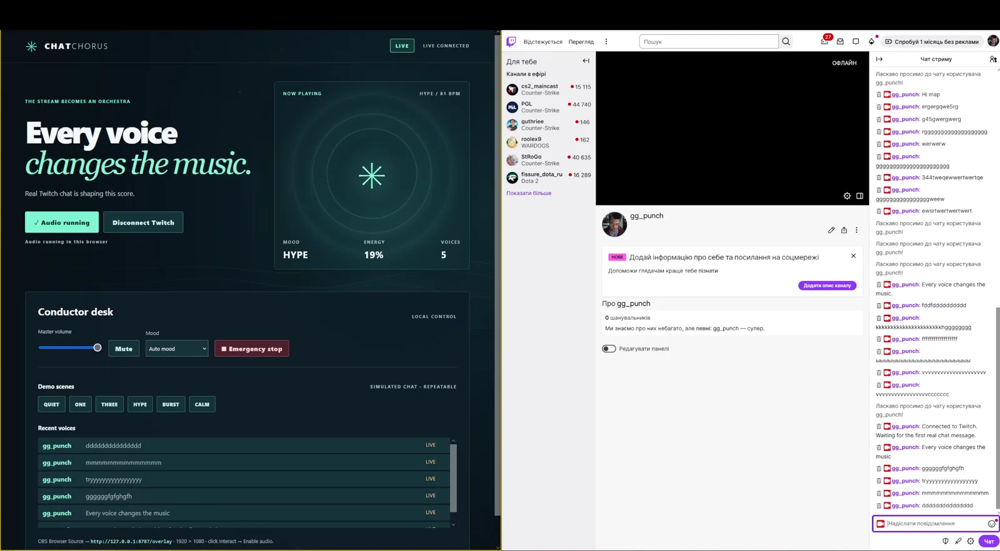
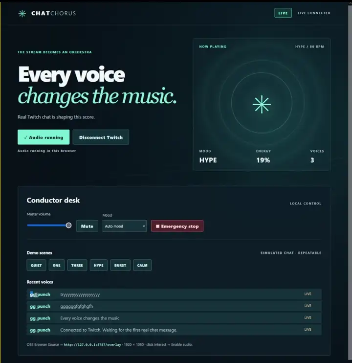
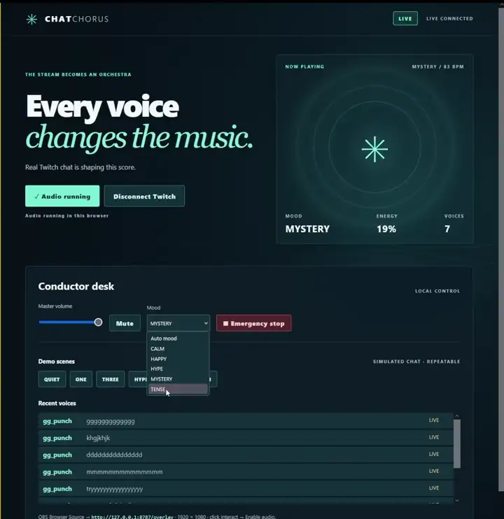
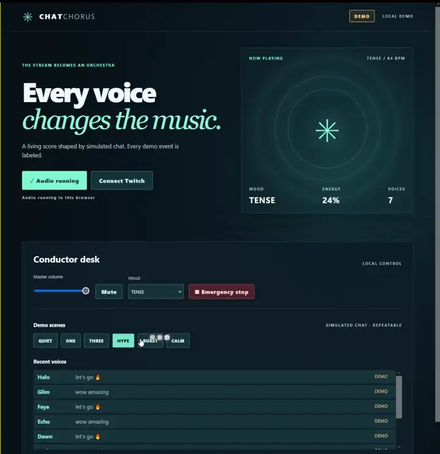

# ChatChorus — The Stream Becomes an Orchestra



**Every chat message becomes a note. Every viewer has a voice.** ChatChorus turns a Twitch stream's conversation into an original, harmonically constrained soundtrack and a responsive OBS scene. A quiet room still has a baseline arrangement; a busy room stays musical.

> **Source labels:** Screenshots marked **LIVE** come from an owner-recorded session on the Twitch channel `gg_punch`. The browser showcase and its six repeatable scenes use **simulated chat**, always labeled DEMO. They do not prove Twitch delivery.

## Real Twitch LIVE demonstration

The owner connected ChatChorus to `gg_punch`, sent real chat messages, heard musical responses, and recorded video with audio in OBS. The supplied source is 1:49 long and has H.264 video and stereo AAC audio. A separate 2:05 contest edit preserves the full recording, normalizes its audio, and adds a short, sourced Codex session excerpt. The MP4 files live outside Git. **YouTube link: pending approved upload.**

| Real chat becomes notes | Mood and energy respond | Labeled simulated demo |
| --- | --- | --- |
|  |  |  |

[See a real LIVE message](docs/assets/live-message.webp) · [Music interface](docs/assets/music-interface.webp) · [Mood change](docs/assets/mood-change.webp) · [Clearly labeled DEMO](docs/assets/demo-labeled.webp)

## Why this exists

Chat reactions usually scroll past and vanish. ChatChorus makes participation audible without asking viewers to learn commands or flooding the stream with soundboard effects. Each viewer receives a stable instrument voice; messages land on the beat and fit the active scale and four-chord progression.

- **Five moods and five voices:** CALM, HAPPY, HYPE, MYSTERY and TENSE guide scales, tempo and energy. A deterministic viewer hash assigns one of five timbres.
- **Musical limits:** One accepted chat message creates one note. Duplicate EventSub IDs are ignored, each viewer has a 180 ms cooldown, the global pipeline accepts at most 24 notes per second, and the synthesizer has an 18-voice ceiling and compressor.
- **Streamer control:** Volume, mute, mood override, disconnect and emergency stop are available from the local control panel.
- **OBS scene:** A separate 1920×1080 Browser Source renders waves, rings and particles and plays the score after its own **Enable audio** gesture.
- **Browser showcase:** Quiet, One, Three, Hype, Burst and Calm use the same music engine without Twitch credentials. Every synthetic event is labeled DEMO.

## Architecture

```text
Twitch channel.chat.message
       │ EventSub WebSocket
       ▼
Local Node/TypeScript controller ── OAuth authorization-code flow
       │  validate · deduplicate · throttle · sanitize
       ▼
Local WebSocket broadcast
       ├── Control panel: Web Audio + streamer controls
       └── OBS /overlay: Web Audio + living-score visualization

Static showcase: same music/audio modules + labeled DEMO events
                 no Twitch OAuth, EventSub, backend or credentials
```

The controller handles EventSub welcome, keepalive, planned reconnect and unexpected loss separately. During a planned handoff it retains the old socket until the replacement welcomes it; after an unexpected loss it resubscribes. Tokens remain in controller memory and are never returned to the page.

## Install and run

Requires Node.js **22.23.1+**, npm and a modern Chromium browser. OBS Studio and a Twitch account are needed for the full LIVE setup.

```powershell
npm.cmd ci
npm.cmd run typecheck
npm.cmd test
npm.cmd run build
npm.cmd start
```

Open the control panel at `http://127.0.0.1:8787/`. Click **Enable audio**, then choose **One** to hear a labeled local DEMO. The server binds to loopback only. On systems where `npm` runs normally, `npm` and `npm.cmd` are equivalent.

### Connect Twitch LIVE

1. Register a **confidential** Twitch Developer Application with the exact callback `http://localhost:8787/oauth/callback`.
2. Copy `.env.example` to `.env`, then locally fill `TWITCH_CLIENT_ID`, `TWITCH_CLIENT_SECRET` and `TWITCH_CHANNEL_LOGIN`. Keep `PORT=8787`. Never commit or share the values.
3. Start with `npm.cmd run start:live`, open the control panel and click **Connect Twitch**. Approve `user:read:chat` in Twitch.
4. Send a real message in the configured channel. Confirm **LIVE_CONNECTED**, a **LIVE** feed row, and `liveSeen: true` in `/api/status`.

The registered callback hostname is `localhost`; the HTTP server still listens at `127.0.0.1`. The OAuth authorization and token exchange use the same callback string. See [the owner runbook](LIVE_VERIFICATION_RUNBOOK_RU.md) for detailed acceptance steps.

### Add OBS audio

Add `http://127.0.0.1:8787/overlay` as a **1920×1080 Browser Source**. In OBS, choose **Interact** and click **Enable audio** inside the overlay. Check the OBS mixer meter and a short local recording. The control panel and OBS have separate browser audio contexts. Avoid capturing both audio outputs at once.

## Static showcase

`npm.cmd run build:showcase` produces `dist-showcase/`, a static browser-only bundle suitable for Cloudflare Pages. The real video embed, GitHub link and Devpost link appear only after verified URLs are supplied at build time:

| Optional build variable | Value after publication |
| --- | --- |
| `VITE_PUBLIC_YOUTUBE_ID` | The 11-character ID of the approved public or unlisted YouTube video |
| `VITE_PUBLIC_GITHUB_URL` | The actual published repository URL |
| `VITE_PUBLIC_DEVPOST_URL` | The actual submitted Devpost project URL |

Without those values the page shows the real-video poster and truthful pending labels. It never embeds a fabricated URL. Do **not** add Twitch secrets to the static host. See [Cloudflare Pages settings](DEPLOY_CLOUDFLARE.md).

## Security and verification

`.env`, recordings, final MP4s, build output and local deployment files are ignored by Git. OAuth uses a random expiring `state`, validates token identity and the `user:read:chat` scope, and refreshes tokens server-side. The controller sends sanitized chat events to the local browsers. Run `npm.cmd run preflight:publish` before publishing.

Tests cover OAuth state and parameters, token checks, EventSub reconnect and resubscribe, chat mapping, deduplication, burst limits, demo scenes and safe local routes. The [test report](TEST_REPORT.md) records earlier local results; [final delivery evidence](FINAL_DELIVERY_REPORT.md) separates owner testimony, media inspection and automated checks. Real Twitch/OBS operation is reported by the owner and supported by the supplied recording; it is not inferred from unit tests.

## Built with Codex

The owner directed the concept and approved the architecture. Codex implemented and refined the local controller, OAuth callback, EventSub lifecycle, musical engine, OBS route, static showcase, tests and packaging. It identified and corrected an unsupported PKCE assumption and a WebSocket handoff gap.

- **Primary build session:** `01a1873b-d813-7d70-9e13-65ca2449847b`
- **Earlier setup session:** `01a1872a-ee45-7842-96ff-28c16f8521df`
- [Development evidence map](CODEX_BUILD_EVIDENCE.md)

The final video ends with an English translation of a genuine build note from the primary session log, with its source recorded in the final delivery report. It is an editorial excerpt, not a simulated Codex interface.

**Devpost submission:** pending a verified project URL and owner-authorized submission. [Official rules](https://twitchcon-codex.devpost.com/rules) · [FAQ](https://twitchcon-codex.devpost.com/resources)
